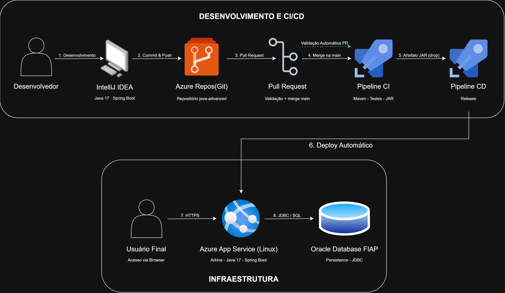

# ArkIve


Plataforma para organizar pacientes, consultas, prescrições e informações clínicas em uma jornada integrada de cuidado animal.

**[Código-fonte](https://github.com/2TDSPO-ArkIve/java-advanced)** · **[Aplicação web (Azure)](https://webapp-arkive-rm561408.azurewebsites.net/)** · **[Demonstração do projeto](https://www.youtube.com/watch?v=8qWFTkmPwE0)**

`Java 17` · `Spring Boot` · `Oracle` · `Thymeleaf` · `Azure DevOps`

> **Sobre este repositório:** aqui estão o backend Java/Spring Boot, a API REST, a interface web administrativa em Thymeleaf e a integração com Oracle. O aplicativo React Native/Expo faz parte do ecossistema ArkIve, mas é mantido separadamente.

## Visão geral

O **ArkIve** foi desenvolvido para reduzir a fragmentação de informações na rotina veterinária. O histórico do paciente reúne informações clínicas, preventivas e terapêuticas, respeitando o vínculo e as permissões de cada usuário.

O suporte por inteligência artificial é **assistivo e opcional**: pode sugerir hipóteses, severidade, confiança, fontes e insights para o profissional avaliar. Ele **não substitui o veterinário**, não confirma autonomamente diagnósticos e não prescreve medicamentos. A decisão clínica final é sempre do profissional responsável.

### Navegar pela documentação

- [Funcionalidades](#funcionalidades)
- [Links do projeto](#links-do-projeto)
- [Stack tecnológica](#stack-tecnológica)
- [Arquitetura da aplicação](#arquitetura-da-aplicação)
- [Arquitetura e CI/CD no Azure](#arquitetura-e-cicd-no-azure)
- [Perfis e segurança](#perfis-de-usuário-e-spring-security)
- [Interface web administrativa](#interface-web-administrativa)
- [Fluxos clínicos e regras de negócio](#fluxos-clínicos-e-regras-de-negócio)
- [Banco de dados e evolução do schema](#banco-de-dados-e-evolução-do-schema)
- [Configuração e execução](#pré-requisitos-para-desenvolvimento)
- [Qualidade e testes](#qualidade-e-testes)
- [Estrutura do projeto](#estrutura-do-projeto)
- [Integrantes](#integrantes)

## Funcionalidades

- **Histórico e identificação de pacientes:** cadastro de animais, ArkIve ID, vínculos com responsáveis e compartilhamento controlado de acesso.
- **Gestão de consultas:** agendamento, acompanhamento dos estados clínicos, narrativa, conclusão profissional e cancelamento com preservação do histórico.
- **Apoio clínico por IA:** análise solicitada pelo veterinário, com resultados provisórios separados de sua conclusão profissional.
- **Prescrições e adesão:** registro de tratamentos, acompanhamento pelo responsável e trilha de eventos clínicos.
- **Acesso e colaboração:** perfis `SYSADMIN`, `ADMIN_CLINICA`, `VETERINARIO` e `RESPONSAVEL`, solicitações de acesso e regras de privacidade.
- **Relatos e notificações:** observações de responsáveis, relatos permanentes e avisos relacionados a consultas.
- **Recursos complementares:** transcrição opcional com Azure Speech, geração de documentos PDF, indicadores Oracle e dashboards administrativos.

O backend atende tanto à **interface web Thymeleaf** quanto aos **clientes que consomem a API REST**. As áreas de administração web estão disponíveis para os perfis autorizados; os fluxos clínicos dos demais perfis são consumidos por clientes da API.

## Links do projeto

| Recurso | Endereço |
| --- | --- |
| Repositório GitHub | [2TDSPO-ArkIve/java-advanced](https://github.com/2TDSPO-ArkIve/java-advanced) |
| Aplicação web no Azure | [webapp-arkive-rm561408.azurewebsites.net](https://webapp-arkive-rm561408.azurewebsites.net/) |
| Instância alternativa no Render | [arkive-b7v2.onrender.com](https://arkive-b7v2.onrender.com/) |
| Projeto Azure DevOps | [Sprint 4 – Azure DevOps](https://dev.azure.com/rm561408/Sprint%204%20%E2%80%93%20Azure%20DevOps) |
| Demonstração de CI/CD e CRUD | [Assistir no YouTube](https://www.youtube.com/watch?v=8qWFTkmPwE0) |

> **Disponibilidade:** os ambientes gratuitos de demonstração podem estar suspensos fora dos períodos de uso. Os endereços acima não indicam disponibilidade contínua.

## Stack tecnológica

| Tecnologia | Uso no projeto |
| --- | --- |
| Java 17 | Linguagem e versão de compilação |
| Spring Boot 3.5.14 | Inicialização, configuração e empacotamento da aplicação |
| Spring MVC / Spring Web | Controllers web e API REST |
| Thymeleaf | Renderização server-side do frontend |
| Thymeleaf Extras Spring Security 6 | Navegação condicionada ao perfil autenticado |
| Spring Security | Form login, HTTP Basic, autorização por perfil e sessão web |
| BCrypt | Hash das senhas persistidas |
| Spring Data JPA / Hibernate | Persistência e consultas ao banco |
| Spring JDBC / `SimpleJdbcCall` | Execução de procedures empacotadas no Oracle e leitura de parâmetros `OUT` |
| Oracle PL/SQL | Package, procedures, função e trigger de indicadores |
| Bean Validation | Validação declarativa de DTOs e formulários |
| Flyway | Criação e evolução versionada do schema |
| Oracle Database / `ojdbc11` | Banco da aplicação no perfil padrão `oracle` |
| Maven Wrapper (Maven 3.9.15) | Execução do build e testes; Maven instalado também é aceito |
| Springdoc OpenAPI 2.8.9 | Documentação complementar da API |
| Apache PDFBox 3.0.8 | Geração de históricos e resumos clínicos em PDF |
| Azure Speech SDK 1.51.0 | Transcrição opcional de áudio clínico |
| FFmpeg | Conversão temporária de M4A, AAC e WebM para WAV na transcrição |
| Docker | Build em múltiplos estágios e imagem Java 17 com dependências de áudio |
| Azure Repos / Git | Versionamento e Pull Requests com validação de build |
| Azure Pipelines | Compilação, testes, publicação do JAR e releases automáticas |
| Azure App Service (Linux) | Execução da aplicação web Java na nuvem |
| JUnit, MockMvc, Spring Security Test e H2 | Testes automatizados sem depender de uma instância Oracle |

O suporte clínico usa ainda o `RestClient` do Spring para consultar o motor clínico externo configurado por `ARKIVE_CLINICAL_ENGINE_URL`.

## Arquitetura da aplicação

O projeto separa apresentação, regras de negócio e persistência. Os mesmos services são usados pelos controllers REST e, quando aplicável, pelos controllers MVC.

```text
Navegador / Mobile / Postman
             │
             ▼
    Controllers REST e MVC
       (Thymeleaf web)
             │
             ▼
 Service + autorização por perfil e escopo
             │
             ├──► Spring Data JPA / Hibernate ──► Oracle (tabelas)
             │
             ├──► Spring JDBC / SimpleJdbcCall ──► Oracle
             │                                     └── PKG_ARKIVE_INDICADORES
             │
             ├──► Motor clínico externo (IA assistiva)
             │
             └──► Azure Speech + FFmpeg (transcrição opcional)
```

| Área | Responsabilidade |
| --- | --- |
| `controller` | Endpoints REST e controllers web MVC |
| `service` | Casos de uso, transações, validações e integrações |
| `repository` | Consultas JPA e chamadas às procedures Oracle via Spring JDBC |
| `entity` | Mapeamento das tabelas Oracle |
| `dto` | Contratos de entrada, saída e formulários |
| `security` / `config` | Autenticação, autorização, senha, CORS e integrações |
| `templates` / `static` | Páginas Thymeleaf, CSS, JavaScript e imagens |
| `db/migration` | Evolução do schema controlada pelo Flyway |

## Arquitetura e CI/CD no Azure

A mesma arquitetura que atende às operações clínicas e administrativas também é utilizada na publicação automatizada do ArkIve. O código é versionado com Git, verificado por testes, empacotado em JAR e implantado no **Azure App Service (Linux)** pelo **Azure DevOps**. O aplicativo React Native/Expo é mantido e distribuído separadamente; essas pipelines publicam apenas esta aplicação Java.




### Passos

1. O desenvolvedor altera o código no **IntelliJ IDEA** e envia commits para uma branch no **Azure Repos**.
2. Uma **Pull Request** direcionada à `main` passa por validação automática de build e testes antes da integração.
3. Após o merge na `main`, a pipeline Classic **`ArkIve - CI`** executa um novo build com **Java 17 e Maven**, incluindo os testes automatizados.
4. A CI publica o arquivo **JAR** como artefato **`drop`**.
5. O novo artefato da `main` aciona a pipeline Classic de Release **`ArkIve - CD`**, que realiza o deploy automático na etapa **Development** do Azure App Service.
6. A aplicação Spring Boot é executada no Azure e utiliza **Oracle FIAP** para persistência de dados via JDBC.

| Componente | Configuração utilizada |
| --- | --- |
| Repositório de integração | Azure Repos, `java-advanced` |
| Pipeline CI | `ArkIve - CI` · build Maven · testes · artefato `drop` |
| Pipeline CD | `ArkIve - CD` · Classic Release · estágio `Development` |
| Hospedagem | Azure App Service Linux · Java 17 |
| Recurso Web App | `webapp-arkive-rm561408` |
| Resource Group | `rg-arkive-rm561408` |
| Plano | `plan-arkive-rm561408` · F1 (Free) |
| Banco de dados | Oracle FIAP, externo ao Azure App Service |

As credenciais Oracle são fornecidas por variáveis de ambiente/App Settings, **sem valores sensíveis no Git**. Para respeitar o limite de sessões no Oracle acadêmico, o perfil `oracle` configura um pool HikariCP com máximo de duas conexões, mínimo ocioso zero e timeout ocioso de 30 segundos **por instância**. Essa configuração não limita outras aplicações que compartilhem o mesmo usuário de banco.

A [demonstração da plataforma e de sua publicação (Sprint 4)](https://www.youtube.com/watch?v=8qWFTkmPwE0) mostra o redesenho do dashboard SysAdmin, a validação da Pull Request, as pipelines, a publicação do JAR, o deploy automático e um CRUD conferido diretamente no Oracle.

> **Observação sobre repositórios:** GitHub e Azure Repos são remotos Git independentes neste projeto; um push para um deles não atualiza automaticamente o outro. O GitHub disponibiliza o código e esta documentação, enquanto a configuração de CI/CD utiliza o Azure Repos.

## Perfis de usuário e Spring Security

| Perfil | Principais permissões |
| --- | --- |
| `SYSADMIN` | Administração global; dashboards; gestão de clínicas, usuários, veterinários e responsáveis; acesso administrativo aos dados do sistema |
| `ADMIN_CLINICA` | Dashboard e gestão de animais no escopo da própria clínica; visualização das consultas, prescrições e adesões vinculadas à clínica |
| `VETERINARIO` | Operações clínicas nas próprias consultas; narrativa, suporte clínico, conclusão, prescrições, transcrição e acesso aos pacientes permitidos |
| `RESPONSAVEL` | Leitura dos animais, consultas e prescrições aos quais está vinculado; relatos permanentes, transcrição opcional, registro da própria adesão e interações destinadas ao responsável |

Os usuários são carregados do banco por um `UserDetailsService` e autenticados por um `DaoAuthenticationProvider`. As senhas são persistidas somente como hashes BCrypt. O navegador usa form login em `/login`, enquanto clientes REST podem usar HTTP Basic.

O `SecurityConfig` restringe rotas por perfil. As áreas `/sysadmin/**` exigem `SYSADMIN`; `/admin/**` aceita `SYSADMIN` ou `ADMIN_CLINICA`. A matriz REST também protege explicitamente recursos administrativos: por exemplo, `/api/clinicas/**` e o CRUD `/api/veterinarios/**` são exclusivos de `SYSADMIN`. A exceção específica `GET /api/veterinarios/me`, declarada antes da regra administrativa, permite apenas ao `VETERINARIO` autenticado consultar o próprio perfil a partir do vínculo presente no principal, sem aceitar ID do cliente.

Além da proteção de rota, `ClinicalAccessService` e os services clínicos validam propriedade e escopo. Assim, o veterinário só altera consultas e prescrições sob sua responsabilidade, o administrador visualiza dados da própria clínica e o responsável acessa vínculos permitidos. Nos indicadores Oracle, a leitura por animal reutiliza `ClinicalAccessService`; a contagem global de pacientes ativos é exclusiva de `SYSADMIN`.

Contas provisionadas automaticamente para clínica ou veterinário recebem uma credencial inicial temporária e ficam marcadas para troca obrigatória. O `MandatoryPasswordChangeFilter` impede o restante da navegação até a alteração em `/alterar-senha`. A nova senha deve ter de 8 a 72 caracteres, com pelo menos uma letra maiúscula, uma minúscula e um número.

O cadastro público mantém rotas separadas e papéis atribuídos pelo servidor: `POST /api/auth/register` cria veterinários e `POST /api/auth/register/responsavel` cria responsáveis. O autocadastro de veterinário exige `senha` e `confirmacaoSenha`, aplica a política de 8–72 caracteres com maiúscula, minúscula e número, armazena BCrypt e cria a conta com `ST_TROCA_SENHA=N`. Isso é independente do cadastro administrativo de veterinários (`POST /sysadmin/veterinarios` ou `POST /api/veterinarios`), que continua provisionando a credencial temporária baseada no e-mail e `ST_TROCA_SENHA=S`. Nenhuma rota pública aceita papel, status ou `trocaSenha` definidos pelo cliente. No cadastro de responsável, `tipoDocumento` é obrigatório e aceita `CPF` ou `RG`. CPF é armazenado sem pontuação após validação dos dois dígitos verificadores; RG é normalizado para maiúsculas, sem pontos, hífens ou espaços, e recebe validação estrutural genérica de 5 a 14 caracteres alfanuméricos, pois não existe um algoritmo nacional único. O telefone é opcional, limitado a 20 caracteres, aparado e preservado em sua forma informada. Registros legados e administrativos podem manter `tipoDocumento=NULL`.

## Interface web administrativa

O ArkIve não é apenas uma API REST. A aplicação possui controllers MVC e páginas Thymeleaf que renderizam dados do backend, enviam formulários para endpoints Spring MVC e exibem mensagens de sucesso ou validação.

| Área | Rotas e telas principais |
| --- | --- |
| Autenticação | `/login` e `/alterar-senha` |
| Início | `/`, com redirecionamento conforme o perfil |
| SysAdmin | `/sysadmin/dashboard` |
| Clínicas | `/sysadmin/clinicas`, criação, edição e desativação |
| Usuários | `/sysadmin/usuarios`, criação, edição, ativação, desativação e redefinição de senha |
| Veterinários | `/sysadmin/veterinarios`, criação, edição e desativação |
| Responsáveis | `/sysadmin/responsaveis`, criação, edição e desativação |
| Administração da clínica | `/admin/dashboard` |
| Animais | `/admin/animais`, criação, detalhe, edição, ativação e desativação |
| Consultas | `/admin/consultas` e `/admin/consultas/{id}` |
| Prescrições | `/admin/prescricoes` e `/admin/prescricoes/{id}` |
| Adesão | `/admin/adesoes` e `/admin/adesoes/{id}` |

Os dashboards mostram indicadores calculados com dados reais do backend. O detalhe da consulta apresenta narrativa, evolução do status, apoios provisórios da IA, parecer veterinário, prescrições e adesões relacionadas.

Os formulários usam `th:object`, `th:field` e `th:errors`; erros de campos e de negócio retornam à página. As submissões web incluem token CSRF. A barra lateral usa as autoridades do Spring Security para mostrar somente a navegação compatível com o perfil.

Atualmente, as áreas web completas são destinadas a `SYSADMIN` e `ADMIN_CLINICA`. `VETERINARIO` e `RESPONSAVEL` autenticam pelo mesmo mecanismo, mas são direcionados a `/acesso-web-restrito`; seus casos de uso operacionais são consumidos pela API/cliente. O README não atribui a esses dois perfis telas Thymeleaf clínicas que não existem no repositório.

## Fluxos clínicos e regras de negócio

### Fluxo 1 — Consulta clínica com suporte ArkIve opcional

```text
AG (Agendada)
  → EP (Em Progresso)
  → narrativa clínica
  ├→ conclusão do veterinário → FI (Finalizada)
  └→ suporte clínico assistido por IA → AP (Aguardando Parecer)
       → conclusão do veterinário → FI (Finalizada)

AG / EP / AP → CA (Cancelada)
```

1. Uma consulta é criada/agendada, normalmente com status `AG`.
2. O veterinário responsável inicia o atendimento; o service valida o vínculo, os recursos ativos e a transição `AG → EP`.
3. A narrativa clínica é registrada e pode ser corrigida enquanto a consulta está em `EP` ou `AP`.
4. O suporte ArkIve é opcional. O veterinário pode finalizar diretamente de `EP` para `FI`, sem criar diagnóstico de IA, ou pode solicitar explicitamente o suporte clínico em `EP`.
5. Quando solicitado, a aplicação consulta o motor externo. A hipótese, severidade, confiança, insight e os metadados opcionais de tokens (`entrada`, `saida`, `total`) são persistidos como apoio provisório; URLs externas e referências RAG estruturadas (`fonte` da organização + `titulo`) permanecem separadas. O registro nasce com `confirmado=N` e `validacaoVet=NULL`, e a consulta avança para `AP`.
6. De `EP` ou `AP`, o veterinário informa sua própria conclusão diagnóstica ou clínica. O registro profissional separado nasce com `confirmado=S`, `validacaoVet=NULL` e sem metadados de IA.
7. `doencaId` e severidade são opcionais. A severidade aceita `AUSENTE`, `LEVE`, `MODERADA` ou `GRAVE`; `AUSENTE` registra explicitamente ausência de severidade, enquanto `null` significa não informado. Não existem doenças fictícias no catálogo.
8. Consultas `AG`, `EP` ou `AP` podem ser canceladas e preservadas no histórico como `CA`. Uma observação do responsável consumida ao iniciar permanece como snapshot mesmo após cancelamento; cancelar ainda em `AG` não a consome.
9. A API transporta datas e horas em ISO-8601, por exemplo `2026-10-20T14:30:00`; formatação de exibição é responsabilidade do cliente.

Comandos:

```http
POST  /api/consultas/{id}/iniciar
PATCH /api/consultas/{id}/narrativa
POST  /api/consultas/{id}/suporte-clinico
GET   /api/consultas/{id}/suporte-clinico
POST  /api/consultas/{id}/finalizar
POST  /api/consultas/{id}/cancelar
```

`GET /api/consultas` aceita os filtros combináveis `consultaId` (igualdade exata), `pacienteNome` (trecho, sem diferenciar maiúsculas/minúsculas), `arkivePatientId` (igualdade exata sem diferenciar maiúsculas/minúsculas), `dataHoraInicio` e `dataHoraFim` (limites inclusivos em ISO-8601), além dos filtros existentes `animalId`, `veterinarioId`, `clinicaId`, `status` e `modalidade`. Os filtros são aplicados no banco antes da paginação e nunca ampliam o escopo autorizado do usuário.

Esse fluxo não é CRUD simples porque contém uma máquina de estados, regras de transição, autorização pelo veterinário responsável, chamada externa, validação e persistência do resultado provisório, distinção entre hipótese da IA e conclusão profissional e registro de eventos da jornada.

O `POST /api/consultas/{id}/suporte-clinico` é síncrono: a chamada ao motor ocorre fora da transação de banco, e somente depois de uma resposta válida uma transação curta persiste o diagnóstico e muda `EP` para `AP`. Se o cliente parar de aguardar, mas Java e o motor concluírem dentro do timeout do servidor, o resultado ainda é persistido. O cliente deve consultar `GET /api/consultas/{id}/suporte-clinico` antes de tentar gerar novamente; esse GET lê exclusivamente o resultado persistido e não chama o motor.

Enquanto uma geração está em andamento, um segundo POST para a mesma consulta retorna `409` e não inicia outra chamada. Essa proteção usa memória local (`ConcurrentHashMap`) e, portanto, cobre a instância Java atual; o projeto opera como instância única e não introduz bloqueio distribuído. Se a consulta deixar de estar em `EP` enquanto o motor responde, a persistência rejeita o resultado para não anexar suporte a uma consulta cancelada ou já alterada.

Os timeouts padrão são 10 segundos para conexão e 120 segundos para leitura. Podem ser ajustados com `ARKIVE_CLINICAL_ENGINE_CONNECT_TIMEOUT` e `ARKIVE_CLINICAL_ENGINE_READ_TIMEOUT`. Se o motor ultrapassar o timeout Java, a requisição termina com `503` sanitizado e nenhuma resposta posterior daquele pedido pode ser recuperada pelo Java; uma nova geração poderá ser solicitada conforme o estado da consulta.

### Fluxo 2 — Prescrição e adesão

Fluxo principal:

```text
consulta FI → prescrição veterinária → adesão do responsável → histórico terapêutico
```

1. A consulta precisa estar finalizada (`FI`).
2. O veterinário responsável cria a prescrição com medicamento, dosagem, frequência, via, período, instruções e, opcionalmente, o custo total estimado ou registrado do tratamento. Esse valor não representa preço unitário nem controle de estoque.
3. O sistema valida a autoria clínica, o estado da consulta, a via de administração e as datas do tratamento.
4. O responsável autenticado e vinculado ao animal registra se houve adesão, informando a prescrição, `S` ou `N` e uma observação opcional.
5. O servidor deriva o responsável e o animal da identidade autenticada e da prescrição, valida o vínculo e confirma que o registro está dentro do período do tratamento.
6. A adesão é persistida com data definida pelo servidor e gera um evento `ADESAO_REGISTRADA`.
7. O histórico de adesão não pode ser editado nem excluído; uma prescrição com adesão registrada também não pode ser alterada ou removida.

Endpoints principais:

```http
POST /api/prescricoes
GET  /api/prescricoes
POST /api/adesoes-prescricao
GET  /api/adesoes-prescricao
```

Esse fluxo não é CRUD simples porque depende do encerramento de outro processo, impõe autoria e vínculo, valida a janela terapêutica, completa dados pelo contexto autenticado, produz evento de jornada e preserva um histórico imutável.

### Fluxo 3 — Custos assistenciais do paciente

Consultas e prescrições podem registrar, opcionalmente, `valorConsulta` e `valorMedicamento`. Esses dados são custos informativos associados ao cuidado do paciente; não representam faturamento, pagamento, estoque ou contabilidade. `valorMedicamento` é o custo total estimado ou registrado daquela prescrição/tratamento, e não um preço unitário.

O endpoint `GET /api/animais/{animalId}/custos` reutiliza as regras clínicas de leitura do paciente e retorna somente consultas finalizadas (`FI`), em ordem da mais recente para a mais antiga. Para um responsável autorizado, a visão continua abrangendo os custos do paciente. Para um veterinário, consultas, totais e contagens são limitados ao trabalho daquele próprio profissional; acesso clínico compartilhado não concede acesso aos preços de outro veterinário.

O endpoint `GET /api/veterinarios/me/custos` usa exclusivamente o `veterinarioId` da identidade autenticada e apresenta o dashboard financeiro das consultas finalizadas daquele veterinário. Não existe parâmetro de ID de veterinário que permita trocar a titularidade do dashboard. Cada animal é identificado também pelo ArkIve ID.

A resposta separa total de consultas, total de medicamentos e total geral, além do detalhamento por consulta. Nos dashboards próprios, `NULL` significa que nenhum custo foi registrado; no detalhe e no histórico clínico genéricos, um campo monetário nulo também pode significar que o valor foi redigido por privacidade financeira. Valores ausentes contribuem como zero somente nas agregações. Um zero explícito permanece zero e conta como valor registrado.

### Fluxo 4 — Cadastro, busca e observação do paciente pelo responsável

O responsável autenticado pode cadastrar um animal próprio e editar seus dados demográficos enquanto mantiver vínculo ativo e vigente. O cadastro cria atomicamente o primeiro vínculo principal, força o paciente como ativo e não permite que o responsável defina clínica, veterinário de cadastro ou estado administrativo. Raças devem existir previamente; o perfil `RESPONSAVEL` não pode criá-las.

As listagens de animais aceitam `busca` para localizar, sem diferenciar maiúsculas e minúsculas, parte do nome ou do ArkIve ID. O parâmetro legado `nome` continua aceito; quando ambos são enviados, `busca` prevalece. O ArkIve ID é identidade pública permanente do paciente e nunca é credencial de autorização.

O primeiro responsável também pode ser estabelecido pelo resgate de um convite seguro `RESPONSAVEL`. Se não existir vínculo vigente, o resgatante se torna principal; resgates posteriores mantêm a semântica de cuidador não principal. O token continua aleatório, expirável, de uso único e armazenado apenas como hash.

`GET` e `PATCH /api/animais/{animalId}/observacao-responsavel` permitem que somente um responsável atualmente vinculado leia ou altere uma observação pendente de até 2000 caracteres. A observação é copiada para a primeira consulta que efetivamente transicionar de agendada para em progresso e então removida do animal; consultas posteriores não a repetem. O snapshot permanece na consulta histórica.

### Fluxo 5 — Notificações de consultas

Ao criar uma consulta com sucesso, o backend persiste uma notificação `CONSULTA_AGENDADA` para cada usuário `RESPONSAVEL` ativo com vínculo ativo e vigente com o animal. A mensagem identifica o paciente pelo nome e pelo ArkIve ID. Se ainda não existir responsável vigente, nenhuma notificação órfã ou retroativa é criada.

Um agendador consulta, a cada 60 segundos por padrão, somente consultas `AG` compreendidas entre o instante atual e o limite configurado. Para cada resultado, o usuário `VETERINARIO` ativo vinculado ao profissional da consulta recebe `LEMBRETE_CONSULTA`. A antecedência padrão é de 30 minutos e pode ser alterada por `arkive.notifications.consultation-reminder.minutes-before`; a cadência usa `arkive.notifications.consultation-reminder.poll-ms`.

As chaves `CONSULTA_AGENDADA:<consultaId>` e `LEMBRETE_CONSULTA:<consultaId>:<dataHora>` tornam a criação idempotente por destinatário. Assim, varreduras repetidas não duplicam lembretes, enquanto um reagendamento para outro horário pode gerar um novo lembrete quando entrar na janela. A caixa de notificações persistidas permanece a fonte autoritativa; a preferência `ST_NOTIFICACAO=N` suprime apenas o push do responsável. O envio push continua opcional e ocorre somente após o commit da transação.

### Fluxo 6 — Solicitação veterinária de acesso

O ArkIve ID identifica permanentemente o paciente, mas não autoriza acesso. Um `VETERINARIO` autenticado pode enviar `POST /api/solicitacoes-acesso` com o ArkIve ID; isso cria somente uma solicitação `PENDING`, sem revelar metadados clínicos nem conceder acesso. É necessário existir ao menos um responsável ativo e vigente, e não pode haver outra solicitação pendente do mesmo veterinário para o mesmo paciente.

Cada responsável elegível recebe na caixa persistida uma notificação `SOLICITACAO_ACESSO`, vinculada ao recurso da própria solicitação. A criação da solicitação e das notificações usa a mesma transação; o push opcional continua sendo disparado somente depois do commit. A lista e o detalhe são limitados ao veterinário solicitante ou aos responsáveis atualmente vinculados ao animal.

Um responsável vigente pode usar `POST /api/solicitacoes-acesso/{id}/aprovar` ou `/rejeitar`. A aprovação reutiliza o serviço canônico para criar ou recuperar um `PatientAccess` de papel `VETERINARIO`; a rejeição não concede nem revoga acesso. A decisão é serializada por bloqueio pessimista, não duplica paciente, relação de responsável, convite ou acesso efetivo. O acesso clínico aprovado continua independente da privacidade financeira: o veterinário não passa a ver preços registrados por outro profissional. QR code, link HTTPS e código manual do compartilhamento existente permanecem alternativas válidas.

### Fluxo 7 — Relatos permanentes do animal

Um `RESPONSAVEL` ativo e atualmente vinculado pode criar um relato em `POST /api/animais/{animalId}/relatos`. O texto tem no máximo 2.000 caracteres, a data de ocorrência é opcional e não pode estar no futuro segundo o calendário `America/Sao_Paulo`, e `originadoDeTranscricao` registra apenas a origem informada pelo cliente. Autor, horário de criação, animal e ArkIve ID são determinados pelo backend. O relato é permanente e independente da observação pendente consumida ao iniciar uma consulta; não produz notificação nem evento de jornada.

`GET /api/animais/{animalId}/relatos` reutiliza a autorização clínica de leitura e aceita `busca`, `page` e `size` (padrões 0 e 20, máximo 50). A consulta é paginada no Oracle e ordenada por criação e ID decrescentes. Texto original e texto de busca são armazenados separadamente: a busca remove diacríticos, ignora caixa e usa correspondência literal parcial, sem stemming, sinônimos ou inferência clínica. Assim, `vômito` e `vomito` são equivalentes, `vomitar` não é tratado automaticamente como a mesma palavra, e `vomit` pode localizar ambos.

`POST /api/transcricoes` aceita `VETERINARIO` com `veterinarioId` válido e `RESPONSAVEL` com `responsavelId` válido. A transcrição continua stateless: retorna texto editável e não cria relato, observação, consulta ou narrativa automaticamente.

## Validação de dados

A aplicação valida dados em camadas complementares:

- DTOs com `@NotBlank`, `@NotNull`, `@Size`, `@Email`, `@Positive`, `@Min`, `@Max`, `@DecimalMin` e `@DecimalMax`;
- controllers REST e MVC com `@Valid`;
- formulários MVC com `BindingResult`, retorno à mesma view e mensagens `th:errors`;
- validações de negócio nos services, como transições de consulta, recursos ativos, propriedade clínica, vínculos, datas de tratamento e imutabilidade da adesão;
- constraints Oracle para chaves, unicidade, referências, domínios `CHECK`, datas e JSON.

Entradas inválidas da API recebem respostas pelo tratamento centralizado de exceções. Nos formulários web, os valores preenchidos e os erros compreensíveis são apresentados novamente na página.

## Banco de dados e evolução do schema

O **Flyway controla o versionamento da estrutura relacional Oracle utilizada pelo backend**. As migrations ficam em `src/main/resources/db/migration` e são aplicadas em ordem durante a inicialização do perfil `oracle`. Os objetos PL/SQL de indicadores possuem provisionamento separado das migrations, conforme a documentação de banco de dados do projeto.

| Versão | Migration | Objetivo |
| --- | --- | --- |
| V1  | `V1__create_arkive_schema.sql` | Cria o schema-base com 23 tabelas, chaves, constraints, relacionamentos, colunas identity, comentários e índices |
| V2  | `V2__evolve_usuario_for_security.sql` | Evolui usuários para os quatro perfis, adiciona nome e vínculo de clínica e ajusta constraints de segurança |
| V3  | `V3__add_usuario_password_lifecycle.sql` | Adiciona controle de troca obrigatória e data da última troca de senha |
| V4  | `V4__add_diagnostico_fontes_ia.sql` | Adiciona as fontes consultadas pelo motor clínico ao diagnóstico |
| V5  | `V5__add_animal_veterinario_cadastro.sql` | Registra o veterinário que cadastrou o animal, com chave estrangeira e índice |
| V6  | `V6__add_animal_birth_date_and_consulta_address.sql` | Adiciona data de nascimento do animal e endereço da consulta |
| V7  | `V7__add_patient_identity_and_sharing.sql` | Adiciona a identidade ArkIve do paciente e o compartilhamento de acesso |
| V8  | `V8__backfill_arkive_patient_ids.java` | Preenche identificadores ArkIve para pacientes existentes |
| V9  | `V9__enforce_arkive_patient_id.sql` | Torna obrigatório e único o identificador ArkIve após o preenchimento |
| V10 | `V10__add_notifications.sql` | Adiciona notificações persistidas da jornada do paciente |
| V11 | `V11__correct_ai_diagnosis_validation_semantics.sql` | Corrige a semântica histórica da avaliação veterinária de insights de IA |
| V12 | `V12__add_diagnostico_referencias_rag.sql` | Persiste separadamente os títulos das referências RAG |
| V13 | `V13__add_patient_care_costs.sql` | Adiciona custos assistenciais opcionais de consultas e prescrições |
| V14 | `V14__normalize_responsavel_identity.sql` | Substitui o tipo normal por `RESPONSAVEL`, preserva registros e adiciona o tipo opcional de documento CPF/RG |
| V15 | `V15__add_responsavel_pending_observation.sql` | Adiciona a observação pendente do responsável no animal e seu snapshot consumido pela próxima consulta iniciada |
| V16 | `V16__expand_consulta_notifications.sql` | Expande os tipos de notificação de consulta para agendamento, lembrete e finalização |
| V17 | `V17__add_patient_access_requests.sql` | Adiciona solicitações autenticadas de acesso veterinário, resolução por responsável vigente e o tipo/recurso de notificação correspondente |
| V18 | `V18__add_permanent_animal_reports.sql` | Adiciona o histórico permanente e pesquisável de relatos dos responsáveis por animal |
| V19 | `V19__add_diagnostico_severity_and_token_usage.sql` | Adiciona `AUSENTE` à severidade e persiste metadados opcionais e não negativos de tokens do suporte clínico |

No perfil Oracle:

- `spring.flyway.enabled=true`;
- `spring.flyway.locations=classpath:db/migration`;
- `spring.flyway.baseline-on-migrate=true`, com versão-base `1`;
- `spring.jpa.hibernate.ddl-auto=validate`, portanto o Hibernate valida o modelo e não gera o schema;
- `spring.sql.init.mode=never`, evitando inicialização paralela por scripts SQL do Spring.

As migrations não inserem usuários ou credenciais de demonstração. Elas também **não instalam automaticamente** `PKG_ARKIVE_INDICADORES` nem `TRG_ARKIVE_CONS_PESO`.

## Pré-requisitos para desenvolvimento

### Obrigatórios para a aplicação completa

- JDK 17 disponível em `JAVA_HOME` ou no `PATH`;
- acesso à internet no primeiro uso do Maven Wrapper e para baixar dependências;
- uma instância Oracle e um usuário/schema da aplicação;
- para os endpoints `/api/indicadores/**`, o package e o trigger instalados no Oracle conforme a documentação da integração PL/SQL;
- acesso ao motor clínico externo para demonstrar a etapa de suporte por IA.

O repositório não fixa uma versão específica do Oracle. A instância deve aceitar os recursos usados nas migrations, como colunas `GENERATED BY DEFAULT AS IDENTITY`, constraints com `IS JSON`, CLOBs, índices e chaves estrangeiras.

### Opcionais

- Docker, caso a execução seja feita pela imagem do `Dockerfile`;
- Azure Speech configurado para usar `/api/transcricoes`;
- FFmpeg no `PATH` para converter áudio M4A, AAC ou WebM em execução local. A imagem Docker já instala o FFmpeg.

A narrativa da consulta pode ser enviada como texto sem Azure Speech. Assim, Azure Speech e FFmpeg não são necessários para iniciar a aplicação nem para executar a consulta assistida sem transcrição de áudio.

## Variáveis de ambiente

Nenhum valor real de credencial deve ser versionado. O arquivo `.env.example` existente no repositório serve como referência inicial de nomes; caso esteja indisponível em uma cópia do projeto, consulte a tabela abaixo e defina as variáveis diretamente no ambiente.

| Variável | Finalidade | Obrigatória |
| --- | --- | --- |
| `SPRING_PROFILES_ACTIVE` | Seleciona o perfil; `oracle` já é o perfil padrão | Não, mas recomendada explicitamente |
| `ARKIVE_DB_URL` | URL JDBC Oracle | Sim no perfil `oracle` |
| `ARKIVE_DB_USERNAME` | Usuário/schema Oracle | Sim no perfil `oracle` |
| `ARKIVE_DB_PASSWORD` | Senha do usuário Oracle | Sim no perfil `oracle` |
| `ARKIVE_ORACLE_INDICADORES_SCHEMA` | Proprietário do package `PKG_ARKIVE_INDICADORES`; padrão `RM561996` | Para outro proprietário de package |
| `ARKIVE_JPA_SHOW_SQL` | Habilita log SQL; padrão `false` | Não |
| `ARKIVE_CLINICAL_ENGINE_URL` | URL-base do motor clínico externo; existe uma URL padrão configurada | Não, se a URL padrão for usada |
| `ARKIVE_CLINICAL_ENGINE_CONNECT_TIMEOUT` | Timeout de conexão com o motor clínico; padrão `10s` | Não |
| `ARKIVE_CLINICAL_ENGINE_READ_TIMEOUT` | Timeout de leitura da resposta clínica; padrão `120s` | Não |
| `ARKIVE_BOOTSTRAP_SYSADMIN_ENABLED` | Habilita a criação inicial do SysAdmin; padrão `false` | Não |
| `ARKIVE_BOOTSTRAP_SYSADMIN_NAME` | Nome do primeiro SysAdmin | Sim quando o bootstrap está habilitado |
| `ARKIVE_BOOTSTRAP_SYSADMIN_LOGIN` | Login/e-mail do primeiro SysAdmin | Sim quando o bootstrap está habilitado |
| `ARKIVE_BOOTSTRAP_SYSADMIN_PASSWORD` | Senha inicial do primeiro SysAdmin | Sim quando o bootstrap está habilitado |
| `AZURE_SPEECH_ENDPOINT` | Endpoint do recurso Azure Speech | Somente para transcrição |
| `AZURE_SPEECH_API_KEY` | Chave do Azure Speech | Somente para transcrição |
| `PORT` | Porta HTTP; padrão `8080` | Não |

## Configuração inicial do banco

1. Solicite ou crie um usuário/schema Oracle destinado à aplicação.
2. Conceda a esse usuário permissão de conexão e permissões para criar e evoluir os objetos presentes nas migrations, incluindo tabelas, índices, constraints, chaves estrangeiras e comentários.
3. Configure `ARKIVE_DB_URL`, `ARKIVE_DB_USERNAME` e `ARKIVE_DB_PASSWORD` fora do repositório.
4. Inicie a aplicação com o perfil `oracle`.
5. O Flyway cria a tabela de histórico e aplica automaticamente as migrations pendentes. O Hibernate valida o resultado antes de a aplicação ficar disponível.
6. Para usar `/api/indicadores/**`, confirme que o package PL/SQL e o trigger foram instalados no schema correspondente e que o usuário JDBC tem as permissões necessárias. Essa etapa não é feita pelas migrations `V1`–`V19`.

O repositório não define um script de criação do usuário Oracle nem exige comandos DBA específicos. Não é necessário executar as migrations manualmente.

## Primeiro acesso administrativo

Em um banco limpo, as migrations criam o schema, mas não criam usuários da aplicação. O primeiro `SYSADMIN` pode ser provisionado pelo `InitialSysAdminBootstrap`.

No PowerShell, defina valores próprios antes da primeira inicialização:

```powershell
$env:ARKIVE_BOOTSTRAP_SYSADMIN_ENABLED="true"
$env:ARKIVE_BOOTSTRAP_SYSADMIN_NAME="<nome-do-administrador>"
$env:ARKIVE_BOOTSTRAP_SYSADMIN_LOGIN="<login-ou-email>"
$env:ARKIVE_BOOTSTRAP_SYSADMIN_PASSWORD="<senha-segura>"
```

Ao iniciar a aplicação:

1. o bootstrap verifica se está habilitado;
2. se já existir um `SYSADMIN` ativo, nenhuma conta é criada;
3. caso contrário, nome, login e senha precisam estar preenchidos;
4. a senha é armazenada como hash BCrypt;
5. o novo usuário pode acessar `/login`.

O bootstrap exige os três campos não vazios. Para manter consistência com a política de troca de senha do projeto, use de 8 a 72 caracteres, com maiúscula, minúscula e número. Depois da criação bem-sucedida, desabilite o bootstrap e remova a senha do ambiente:

```powershell
$env:ARKIVE_BOOTSTRAP_SYSADMIN_ENABLED="false"
Remove-Item Env:ARKIVE_BOOTSTRAP_SYSADMIN_PASSWORD
```

O `SYSADMIN` criado pelo bootstrap usa a senha definida pelo operador. A troca obrigatória se aplica às contas provisionadas com credencial temporária e às senhas redefinidas pelo painel.

## Como executar

### Windows / PowerShell

Configure primeiro as variáveis Oracle no ambiente ou na configuração de execução da IDE. Não coloque valores reais no README nem em arquivos versionados.

Testes:

```powershell
.\mvnw.cmd test
```

Build sem repetir os testes:

```powershell
.\mvnw.cmd package -DskipTests
```

Execução com Oracle e Flyway:

```powershell
.\mvnw.cmd spring-boot:run "-Dspring-boot.run.profiles=oracle"
```

Execução do JAR empacotado:

```powershell
java -jar target\arkive-0.0.1-SNAPSHOT.jar --spring.profiles.active=oracle
```

### Linux / macOS

```bash
./mvnw test
./mvnw package -DskipTests
./mvnw spring-boot:run -Dspring-boot.run.profiles=oracle
```

O perfil `local-nodb` existe somente para uma inicialização técnica sem banco e desabilita DataSource, JPA e Flyway:

```powershell
.\mvnw.cmd spring-boot:run "-Dspring-boot.run.profiles=local-nodb"
```

Esse perfil não permite demonstrar o frontend autenticado nem os fluxos persistidos.

### Docker opcional

O `Dockerfile` compila a aplicação com Java 17 e Maven e gera uma imagem de runtime Java 17 com FFmpeg e bibliotecas do Azure Speech.

```powershell
docker build -t arkive .
docker run --rm -p 8080:8080 --env-file .env arkive
```

Crie o `.env` localmente com as variáveis necessárias (o `.env.example` pode servir como modelo), substitua os placeholders e não versione o arquivo com valores reais. Se o package estiver em outro schema, inclua também `ARKIVE_ORACLE_INDICADORES_SCHEMA`.

## Acesso à aplicação

Com a execução local na porta padrão:

| Recurso | URL |
| --- | --- |
| Aplicação web / login | [http://localhost:8080/login](http://localhost:8080/login) |
| Entrada da aplicação | [http://localhost:8080/](http://localhost:8080/) |
| Dashboard SysAdmin | [http://localhost:8080/sysadmin/dashboard](http://localhost:8080/sysadmin/dashboard) |
| Dashboard da clínica | [http://localhost:8080/admin/dashboard](http://localhost:8080/admin/dashboard) |
| Health check | [http://localhost:8080/api/health](http://localhost:8080/api/health) |

Após o login, `/` redireciona `SYSADMIN` para `/sysadmin/dashboard`, `ADMIN_CLINICA` para `/admin/dashboard` e os demais perfis para `/acesso-web-restrito`.

Aplicação web no Azure (pode estar temporariamente parada):

- [https://webapp-arkive-rm561408.azurewebsites.net/](https://webapp-arkive-rm561408.azurewebsites.net/)

Hospedagem alternativa no Render (a disponibilidade depende do estado do serviço):

- aplicação: [https://arkive-b7v2.onrender.com/](https://arkive-b7v2.onrender.com/)
- login direto: [https://arkive-b7v2.onrender.com/login](https://arkive-b7v2.onrender.com/login)

O Swagger é documentação complementar para desenvolvimento e demonstração da API; a interface principal para uso administrativo web é o frontend Thymeleaf:

- Swagger UI: `http://localhost:8080/swagger-ui/index.html`
- OpenAPI JSON: `http://localhost:8080/v3/api-docs`

O repositório não contém contas de demonstração ou senhas públicas. Use o bootstrap inicial ou contas provisionadas por um `SYSADMIN`.

## Qualidade e testes

Em uma execução anterior da suíte automatizada, após a integração das procedures Oracle, foi registrado:

```text
Tests run: 847
Failures: 0
Errors: 0
Skipped: 0
BUILD SUCCESS
```

Esse número é um registro histórico de **execuções automatizadas de diferentes categorias**, não um total atualizado da branch nem 847 testes estritamente unitários. Abrange testes unitários, de camada MVC e de integração simulada. O resultado acima foi registrado na implementação local; para validar outra revisão, reexecute a suíte e consulte o relatório Maven Surefire atualizado, em `target/surefire-reports`.

Também foi validado o empacotamento em um JAR executável Spring Boot com:

```powershell
.\mvnw.cmd package -DskipTests
```

Os testes automatizados utilizam JUnit 5, Mockito, MockMvc e, nas classes de integração JPA, H2. Cobrem controllers MVC/REST, Spring Security, ciclo de senha, serviços, autorização clínica, fluxos de consulta, prescrição/adesão, repositories, PDFs, transcrição e integração simulada com o motor clínico. Para os indicadores Oracle, foram adicionados testes específicos de `IndicadoresOracleRepository`, `IndicadoresService` e `IndicadoresController`, inclusive de autorização e retorno `503`. Esses testes não substituem a validação manual com Oracle real nem fornecem, por si sós, percentual de cobertura de código; o projeto não apresenta relatório JaCoCo configurado.

## Estrutura do projeto

```text
src/
├── main/
│   ├── java/br/com/fiap/arkive/
│   │   ├── bootstrap/
│   │   ├── config/
│   │   ├── controller/
│   │   │   └── web/
│   │   ├── domain/
│   │   ├── dto/
│   │   ├── entity/
│   │   ├── exception/
│   │   ├── repository/
│   │   ├── security/
│   │   └── service/
│   │       ├── clinical/
│   │       └── speech/
│   └── resources/
│       ├── db/migration/
│       ├── static/
│       └── templates/
└── test/
    ├── java/br/com/fiap/arkive/
    └── resources/fixtures/
```

### Componentes de indicadores Oracle

Os arquivos principais da integração estão distribuídos entre as pastas `controller`, `service`, `repository`, `dto/response` e `exception`:

```text
src/main/java/br/com/fiap/arkive/
├── controller/IndicadoresController.java
├── service/IndicadoresService.java
├── repository/IndicadoresOracleRepository.java
├── dto/response/AnimalConsultasIndicadorResponse.java
├── dto/response/PacientesAtivosIndicadorResponse.java
└── exception/IndicadoresDatabaseException.java

src/test/java/br/com/fiap/arkive/
├── controller/IndicadoresControllerMvcTest.java
├── service/IndicadoresServiceTest.java
└── repository/IndicadoresOracleRepositoryTest.java
```

Documentação complementar existente:

- [Arquitetura da solução](docs/arquitetura.md)
- [Cronograma de desenvolvimento](docs/cronograma-desenvolvimento.md)
- [Collection Postman](docs/postman/arkive-collection.json)
- [Modelo de dados Oracle](docs/database/Arkive_modelo_oracle_v6.sql)

## Integrantes

Gustavo Crevelari Monteiro Porto — RM561408

Lucca de Araujo Gomes — RM561996

Rafaela Ferreira Santos — RM561671

Victor Sabelli Rocha Batista — RM566224